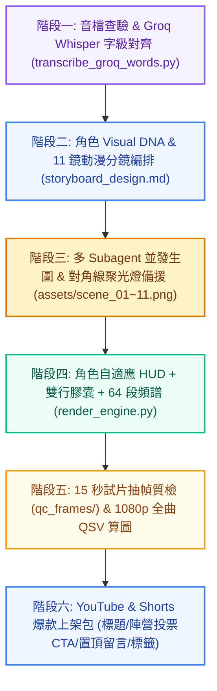

# 🎤 Suno Battle MV Architect — Suno AI 音樂對決與多角色動態歌詞 MV 全自動製片廠

> 專為 **Google Antigravity**、**Claude Code**、**Cursor** 與 **OpenAI Codex / ChatGPT App** 打造的 AI 音樂對決與多角色動態歌詞 MV 全自動製片技能。  
> 針對 **Suno AI**、**Udio** 生成之歌曲（雙人說唱對決 Rap Battle、歷史/動漫跨時空交鋒、多角色對唱主題曲），一鍵端到端轉化為 **1080p 30fps 音訊反應式動態歌詞 MV**，並同步產出 **SRT 字幕包**、**抽幀品質審查報告**與 **YouTube Shorts 爆款互動上架文案包**！

[](https://github.com/JeffreyHo0520/suno-battle-mv-architect)
[](https://github.com/JeffreyHo0520/suno-battle-mv-architect)
[](https://github.com/JeffreyHo0520/suno-battle-mv-architect)
[](https://ffmpeg.org/)
[](https://groq.com/)
[](https://www.python.org/)
[](LICENSE)

---

## ⚡ 六大核心技術突破與防呆機制

1. **多角色陣營主題色動態切換 (Speaker-Adaptive Theme Engine)**：
   - 依據當前演唱角色即時自動切換頂部 HUD 狀態列、歌手膠囊徽章、底部 64 段音訊頻譜條與飄浮粒子的主題色溫（如：青龍 `#00E5FF`、赤虎 `#EF4444`、主持琥珀金 `#F59E0B`、副歌交鋒紫金 `#D946EF`）。
2. **音訊能量反應式視覺 (Audio-Reactive Bass & Spectrum)**：
   - 自動提取 30fps RMS 音訊能量包絡線，驅動低音重拍微震動（Bass Camera Shake）、畫面呼吸感縮放，以及底部 64 段高斯平滑鏡像頻譜條。
3. **零豆腐字規範 (Zero-Tofu Glyph Enforcement)**：
   - 針對 Windows 內建微軟正黑體粗體（`msjhbd.ttc`）不支援彩色 Emoji 導致的方框缺字（`▯`），強制採用原生支援之幾何符號（`◆`、`★`、`【`、`】`），達成 100% 乾淨無缺字。
4. **Windows 中文路徑安全讀寫 (Unicode-Safe OpenCV I/O)**：
   - 全面以 `np.fromfile` + `cv2.imdecode` 與 `cv2.imencode` + `.tofile` 取代傳統 `cv2.imread` / `cv2.imwrite`，徹底根絕桌面與中文專案路徑引發的靜默崩潰。
5. **分鏡限流自動合成備援 (Rate-Limit Composite Fallback)**：
   - 若並行生圖遇到 API 429 限流，內建**對角線分割聚光燈合成器**（Diagonal Split Spotlight Compositor），自動將雙方角色特寫與模糊舞台背景融合成高張力對峙畫面，保證 11 鏡 100% 順暢產出。
6. **Intel QSV 硬體加速正確偵測 (`-pix_fmt nv12`)**：
   - 顯式帶入 `-pix_fmt nv12` 進行 QSV 探測，達成 14~25 fps 極速渲染（無 QSV 環境自動降級 `libx264 -preset ultrafast`）。

---

## 🚀 完整執行架構 (Standard 6-Stage Workflow)



---

## 💻 另一台電腦快速安裝指南 (Installation on Another Computer)

本技能支援在任何安裝有 **Antigravity**、**Claude Code**、**Cursor** 或 **Codex** 的電腦上一鍵部署。

### 方式一：Windows PowerShell 一鍵聯網安裝（最推薦 ⚡）

在目標電腦打開 **PowerShell**，複製並執行以下指令，即可從 GitHub 下載並將技能部署到全域目錄：

```powershell
irm https://raw.githubusercontent.com/JeffreyHo0520/suno-battle-mv-architect/main/install.ps1 | iex
```

> **提示**：若目標電腦已有舊版並想強制覆寫，可加上 `-Force`：
> ```powershell
> & ([scriptblock]::Create((irm https://raw.githubusercontent.com/JeffreyHo0520/suno-battle-mv-architect/main/install.ps1))) -Force
> ```

---

### 方式二：macOS / Linux 終端機一鍵聯網安裝

在 macOS 或 Linux 終端機執行：

```bash
curl -fsSL https://raw.githubusercontent.com/JeffreyHo0520/suno-battle-mv-architect/main/install.sh | bash
```

---

### 方式三：Git Clone 本機安裝

若希望保留原始碼並可透過 `git pull` 隨時獲得最新功能：

```powershell
# 1. Clone 儲存庫
git clone https://github.com/JeffreyHo0520/suno-battle-mv-architect.git

# 2. 進入目錄並執行安裝
cd suno-battle-mv-architect
.\install.ps1
```

macOS / Linux：
```bash
cd suno-battle-mv-architect
chmod +x install.sh
./install.sh
```

---

### 方式四：手動複製安裝

將 `skills/suno-battle-mv-architect` 目錄複製到對應的 AI Agent 技能目錄：

| 平台 / Agent 工具 | 目標目錄 (Skills Directory) |
| :--- | :--- |
| **Google Antigravity** | `~/.gemini/config/skills/suno-battle-mv-architect` |
| **Claude Code** | `~/.claude/skills/suno-battle-mv-architect` |
| **OpenAI Codex / ChatGPT App** | `~/.codex/skills/suno-battle-mv-architect` 或 `~/.agents/skills/suno-battle-mv-architect` |
| **特定專案工作區 (Workspace)** | `./.agents/skills/suno-battle-mv-architect` 或 `./.gemini/skills/suno-battle-mv-architect` |

---

## 🌐 讓其他 AI Agent 直接線上讀取技能 (Direct URLs for AI Agents)

若另一台電腦的 AI Agent（如 Claude、Cursor、GPT-4o、DeepSeek 等）具備聯網或讀取網址功能，可直接提供以下 GitHub 原始檔連結給 Agent 讀取：

- **技能規格定義檔 (SKILL.md)**：  
  `https://raw.githubusercontent.com/JeffreyHo0520/suno-battle-mv-architect/main/skills/suno-battle-mv-architect/SKILL.md`
- **渲染引擎模板 (render_engine_template.py)**：  
  `https://raw.githubusercontent.com/JeffreyHo0520/suno-battle-mv-architect/main/skills/suno-battle-mv-architect/scripts/render_engine_template.py`
- **Groq Whisper 字級對齊腳本 (transcribe_groq_words.py)**：  
  `https://raw.githubusercontent.com/JeffreyHo0520/suno-battle-mv-architect/main/skills/suno-battle-mv-architect/scripts/transcribe_groq_words.py`

---

## 🎯 快速開始與使用指令 (Quick Start)

當使用者提供一首音檔（如 `battle_song.mp3`）與歌詞時：

```powershell
# 1. 複製渲染引擎模板到專案根目錄
$SkillDir = if (Test-Path "$HOME\.gemini\config\skills\suno-battle-mv-architect") { "$HOME\.gemini\config\skills\suno-battle-mv-architect" } elseif (Test-Path "$HOME\.claude\skills\suno-battle-mv-architect") { "$HOME\.claude\skills\suno-battle-mv-architect" } else { "$HOME\.codex\skills\suno-battle-mv-architect" }
Copy-Item "$SkillDir\scripts\render_engine_template.py" ".\render_engine.py"

# 2. 使用 Groq Whisper 提取字級時間戳 (需設定 GROQ_API_KEY)
python "$SkillDir\scripts\transcribe_groq_words.py" --audio "battle_song.mp3" --output "whisper_raw.json"

# 3. 渲染 15 秒橫式試片抽幀質檢 (16:9 橫式)
python render_engine.py --mode preview --encoder auto --audio "battle_song.mp3" --timeline "lyrics_timeline.json" --output "battle_15s_preview.mp4"

# 4. 全曲 1080p 完整版渲染 (16:9 橫式)
python render_engine.py --mode full --encoder auto --audio "battle_song.mp3" --timeline "lyrics_timeline.json" --output "battle_full.mp4"

# 5. 渲染 YouTube Shorts 專用 9:16 直式滿版 (1080x1920)
python render_engine.py --mode full --aspect 9:16 --encoder auto --audio "battle_song.mp3" --timeline "lyrics_timeline.json" --output "battle_shorts_9x16.mp4"
```

---

## 📂 產出成果包規範 (Deliverables Package)

每支對決 MV 製作完成後，將交付以下成果：

```text
專案目錄/
├── battle_full.mp4                  # 1080p 30fps 橫式高畫質 MV 成片
├── battle_shorts_9x16.mp4           # 1080x1920 直式滿版 YouTube Shorts 版 (可選)
├── battle_15s_preview.mp4           # 15 秒先導試片
├── lyrics_timeline.json             # 結構化歌詞時間軸 (含 speaker / badge / theme)
├── battle.srt                       # 標準 UTF-8 SRT 字幕檔
├── battle.txt                       # 繁體中文純文字歌詞檔
├── storyboard_design.md             # 11 鏡動漫分鏡腳本與角色 Visual DNA
├── quality_audit_report.md          # 抽幀審查報告 (零缺字、安全區檢驗)
└── youtube_shorts_pack.md           # 3 款爆款標題、陣營投票說明欄、置頂留言、SEO 標籤
```

---

## 🛠️ 前置需求 (Prerequisites)

- **Python**：3.10+ (`winget install Python.Python.3.11`)
- **ffmpeg**：硬體解碼與加速必備 (`winget install Gyan.FFmpeg`)
- **Python 依賴庫**：
  ```bash
  pip install requests opencv-python numpy pillow
  ```
- **Groq API Key**：
  - 用於超高速 Whisper 字級時間戳提取。
  - 設定環境變數 `GROQ_API_KEY=gsk_...` 或儲存於 `~/.groq_api_key`。

---

## 📄 授權條款 (License)

- 本專案採用 **[MIT License](LICENSE)** 開源授權。
- 第三方技術與 API 宣告請參閱 **[NOTICE.md](NOTICE.md)**。
